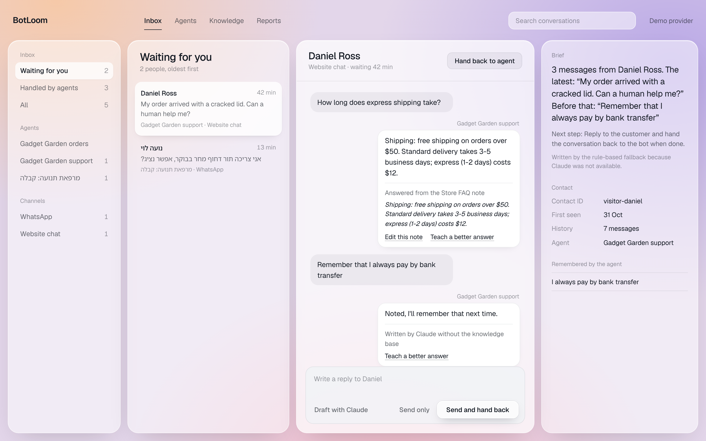
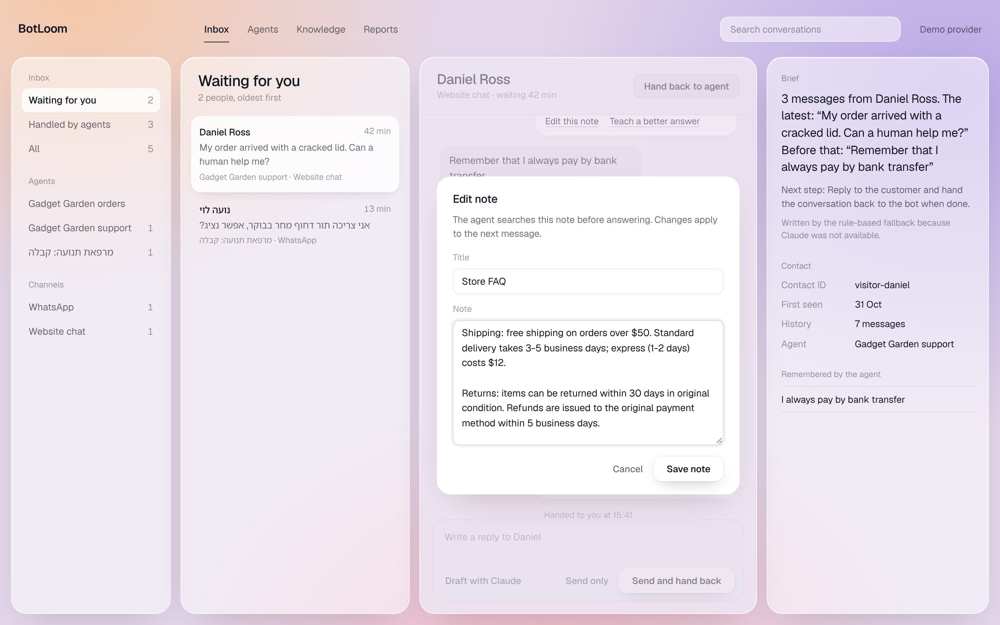
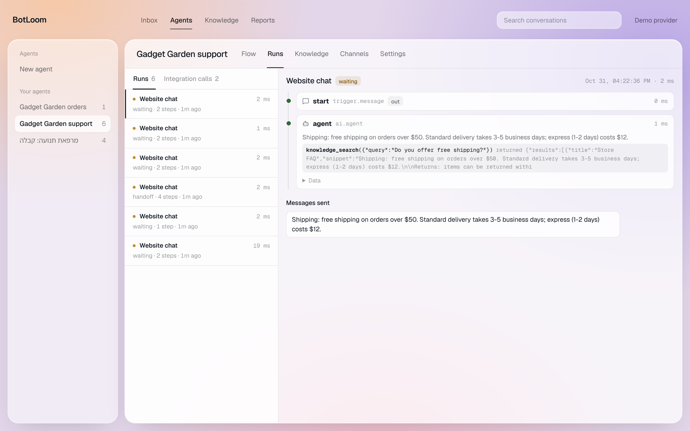
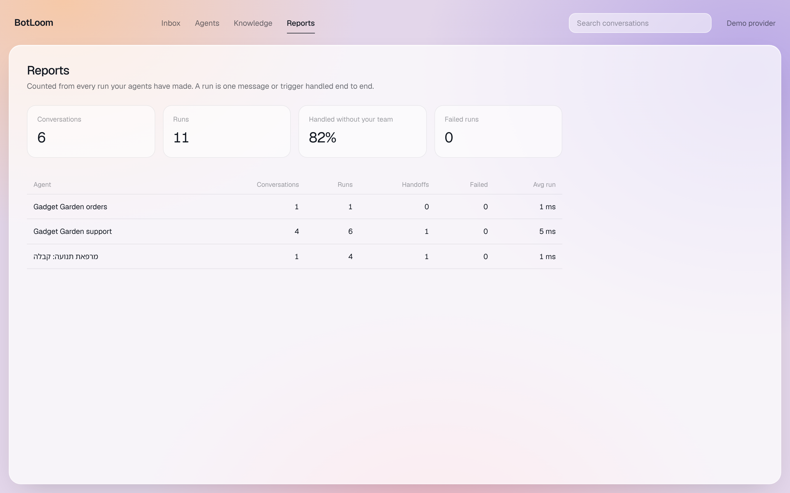
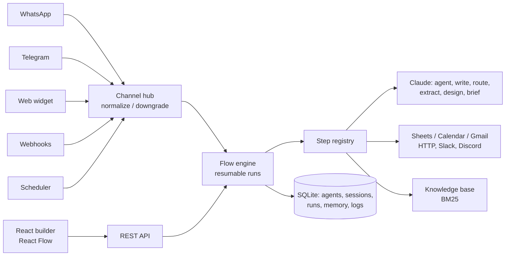

# BotLoom

[עברית](README.he.md)

BotLoom builds customer-facing agents and back-office automations from a description. You write what the agent should do, in Hebrew or English, and Claude designs the flow, the persona and a starter knowledge base. You then refine it on a visual canvas, connect it to WhatsApp, Telegram, Slack, Discord or your website, and read every run step by step.

Conversational bots (menus, questions, validation, handoff to a person) and automations (webhooks, schedules, Google Sheets, Calendar, Gmail) run in one resumable engine. Claude (Opus 5.5) is a step type like any other, so a flow can mix fixed steps with an agent that decides for itself.



## What Claude does in BotLoom

- **Designs agents.** Describe the agent; Claude drafts the flow, checks the graph against the validator, and repairs its own draft (up to three attempts) when a check fails.
- **Edits flows on request.** The command bar above the canvas takes an instruction such as "alert me on Slack for every new lead" and returns a list of proposed changes. Nothing is saved until you press Apply.
- **Answers with tools.** The AI agent step can search the knowledge base, look up rows in Google Sheets, check free calendar slots, book appointments (with a double-booking guard), send email, call your API, remember facts about a contact, and hand off to a person.
- **Remembers contacts.** Facts a customer shares ("I prefer morning appointments") are stored per contact and fed back into later conversations. Card numbers and passwords are refused. Staff can see and delete each fact from the inbox.
- **Writes the handoff brief.** When an agent hands a chat to a person, Claude writes a short brief: what happened, what the customer wants, mood, urgency and the next step.
- **Drafts replies for staff.** In the inbox, "Draft with Claude" writes an answer from the transcript and the knowledge base for a person to edit and send.
- **Shows why it answered.** Every agent answer in the inbox names the knowledge note it came from and quotes the passage. Staff can edit that note in place, or teach a better answer, which becomes a correction note the agent finds next time.
- **Writes text inside automations.** The AI write step produces an email body or summary from flow variables, with a plain-text fallback path if the call fails.
- **Routes and extracts.** Intent routing (each intent is an output) and structured extraction into variables, both with JSON-schema outputs.

## The inbox

One inbox for every agent. "Waiting for you" lists the people an agent handed over, oldest first. Each conversation opens with Claude's brief and what the agent remembers about the customer. "Send and hand back" replies and returns the chat to the agent in one step.

## Channels and integrations

| Where | How |
|---|---|
| WhatsApp | Cloud API, signature-verified webhooks, reply buttons and lists |
| Telegram | Webhook or long polling, inline buttons |
| Website | Embeddable widget (Shadow DOM, right-to-left aware, history per visitor) |
| Slack, Discord | Incoming webhooks for team alerts; only the official hosts are allowed |
| Google | Sheets (add row, find row), Calendar (free slots, create event), Gmail. Without credentials every call runs in a logged sandbox |
| Anything else | HTTP request step with an SSRF guard, inbound webhooks, schedules |

Buttons render natively where a channel supports them and as a numbered menu elsewhere; typing "2" picks the second option.

## Working examples

Three agents ship with the app and run end to end without API keys:

- **מרפאת תנועה: קבלה** (Hebrew physio clinic receptionist): a guided booking path with a busy-slot branch, plus a Claude agent that answers from the knowledge base, checks availability, books and remembers patient preferences.
- **Gadget Garden support**: a store agent that answers from the FAQ, looks up orders, saves leads, remembers returning customers and alerts Telegram and Slack on handoff.
- **Gadget Garden orders**: a webhook automation that logs each order to Sheets, has Claude write a personal thank-you email, alerts the owner on orders over $500, and sends a morning summary on a schedule.

## Quick start

```bash
npm run install:all
npm run build          # builds the web UI
npm start              # http://localhost:8787
```

Add `ANTHROPIC_API_KEY` to `.env` (see [.env.example](.env.example)) for real Claude responses. Without it a deterministic demo provider answers, so the whole app and the test suite work offline. In demo mode the command bar understands alert requests such as "alert me on Slack when someone asks for a human"; any other flow edit needs Claude.

Development: `npm run dev` (API on :8787, UI on :5173). Tests: `npm test`. Docker: `docker compose up --build`.

## Screens

| | |
|---|---|
|  |  |
|  |  |

## Architecture



Details: [docs/architecture.md](docs/architecture.md). Design direction: [docs/DESIGN.md](docs/DESIGN.md).

## Safety

No code execution in templates, an SSRF guard on HTTP steps, a per-agent tool allow-list, an admin token, masked secrets (tokens and webhook URLs), signed or secret-checked webhooks, and a refusal list for sensitive facts in contact memory.

## Tech

TypeScript end to end. Node 22 (`node:sqlite`), Fastify, the Anthropic SDK (Claude Opus 5.5 with adaptive thinking, structured outputs, tool use, streaming and server-side fallbacks), React 19 with React Flow, Geist. 43 Vitest tests cover the engine, channels, security, scheduler, the agent tool loop, designer self-repair, availability, memory, the handoff brief, the flow copilot, the shared inbox and answer explanations.
