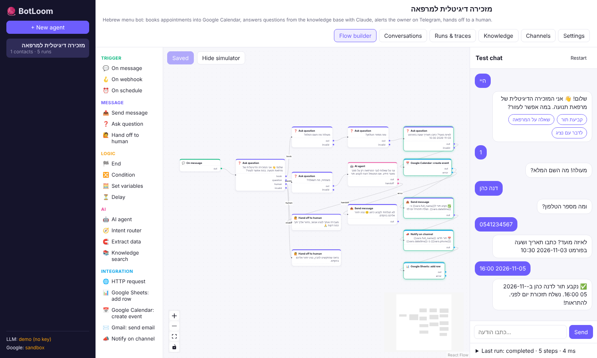
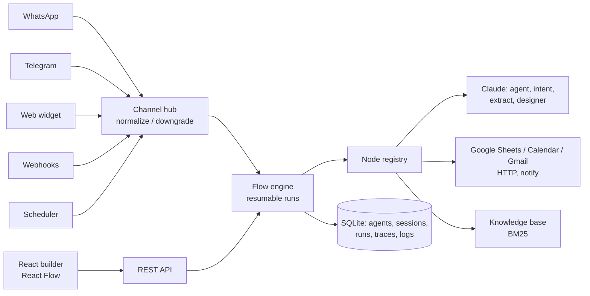

# 🧶 BotLoom: AI-native agent & bot builder

[עברית](README.he.md)

**Describe a bot in plain Hebrew or English and Claude builds it.** Then refine it in a visual flow builder, give
Claude agents real tools (Google Sheets, Calendar, Gmail, your APIs, a knowledge base), connect it to **WhatsApp,
Telegram and your website**, and watch every run step by step.

BotLoom combines two kinds of product that usually live apart:

- **Conversational bots**: menus, questions, validation, human handoff.
- **Automations**: webhooks, schedules, integrations.

Both run in **one resumable engine**, with Claude (Opus 5.5 by default) as a first-class part of the flow.



## Highlights

| | |
|---|---|
| ✨ **AI designer** | Describe the bot; Claude designs the flow, persona and starter knowledge base, validates the graph and **repairs its own draft** if the validator objects |
| 🤖 **Claude agents with tools** | Knowledge search, save lead (Sheets), book appointment (Calendar), send email (Gmail), order lookup (HTTP), human handoff, and **any flow node as a tool** via `{{ai.field}}` placeholders |
| 🧭 **AI routing & extraction** | Intent router (each intent is an output port) and structured extraction into variables, both with JSON-schema structured outputs |
| 💬 **Resumable conversations** | `Ask` nodes pause the run and resume on the contact's next reply, with validation (email, phone, date, number, choice) and retries |
| 📱 **Channels** | WhatsApp Cloud API (signature-verified), Telegram (webhook or long polling), embeddable web widget (Shadow DOM, RTL, history restore), webhooks, schedules |
| 🔁 **Channel downgrade** | Buttons render natively where possible and as a numbered menu elsewhere; typing "2" picks option 2 |
| 🔍 **Observability** | Every run is a trace: node, port taken, input/output, tool calls, token usage, duration. Integration calls are logged (live or sandbox) |
| 🙋 **Human inbox** | Handed-off conversations go silent for the bot; a team member replies from the dashboard and hands back |
| 🔐 **Safe by design** | No code execution in templates, SSRF guard on HTTP, per-agent tool allow-list, admin token, masked secrets, webhook secrets/signatures |
| 🧪 **Runs offline** | SQLite, local BM25 retrieval, deterministic demo LLM: the full demo and the test suite run with no keys |

## Quick start

```bash
npm run install:all
npm run build          # builds the web UI
npm start              # http://localhost:8787
```

Open the dashboard, pick a template (Hebrew clinic receptionist, AI sales agent, order automation) or use the AI designer.
Add `ANTHROPIC_API_KEY` to `.env` (see [.env.example](.env.example)) for real Claude responses; without it a deterministic
demo provider is used.

Development: `npm run dev` (API on :8787, Vite UI on :5173). Tests: `npm test`. Docker: `docker compose up --build`.

## Architecture



Details: [docs/architecture.md](docs/architecture.md).

## Tech
TypeScript end to end · Node 22 (`node:sqlite`) · Fastify · Anthropic SDK (Claude Opus 5.5, adaptive thinking, structured
outputs, tool use, server-side refusal fallbacks) · React 19 + React Flow · Vitest (24 tests: engine, channels, security,
scheduler, AI tool loop, designer self-repair).
